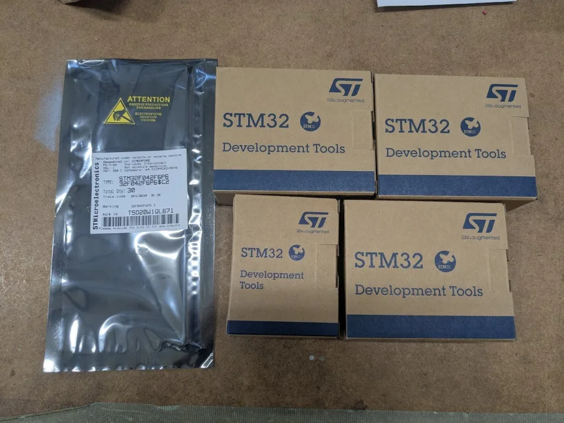

このたび、STM32マイコンをご提供いただきました。

ロボ研では、競技用ロボットの制御系を製作するために、マイコンを使って日々検証や試作を重ねています。今回のご支援は、実機に近い環境で開発を進めたり、より安定した制御方法を検討したりするうえで大きな助けになります。

いただいたSTM32は、今後ロボコン機体を開発する際に、制御システムの開発や周辺機能の試作・検証に活用する予定です。日々のものづくりをご支援いただき、心より感謝いたします。

*ご提供いただいたマイコン*

## 関連リンク

- [Xでのご案内](https://x.com/kisarazu_RBKN/status/1943513142883160210)
- [ユニバーシティ・プログラム - STマイクロエレクトロニクス](https://www.stmcu.jp/university/)
- [支援・協賛ページ]({{ '/support/' | relative_url }})
