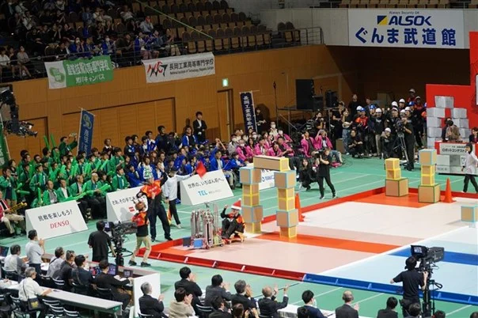
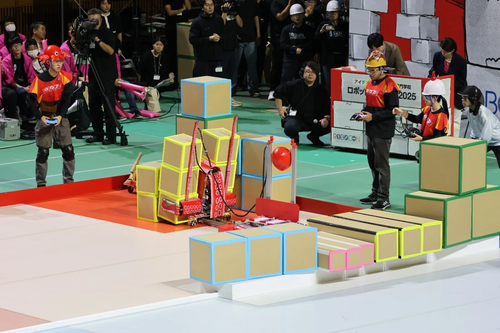

2025年10月12日、高専ロボコン2025 関東甲信越地区大会に出場しました。今年の競技課題は「Great High Gate」です。

## Aチーム：全国大会への出場が決定

*Aチーム「それゆけキサンタクロース」 [写真：木更津高専](https://www.kisarazu.ac.jp/news/2025-%E3%83%AD%E3%83%9C%E3%82%B3%E3%83%B3%E9%96%A2%E6%9D%B1%E7%94%B2%E4%BF%A1%E8%B6%8A%E5%9C%B0%E5%8C%BA%E5%A4%A7%E4%BC%9A%E5%8F%82%E5%8A%A0%E5%A0%B1%E5%91%8A%EF%BC%88%E3%83%AD%E3%83%9C%E3%83%83/)*

Aチーム「それゆけキサンタクロース」は、練習時間を確保するために機体を早めに完成させる方針で準備を進めてきました。本番では操縦ミスや機械トラブルもありましたが、機体全体の完成度は高く、9年ぶりに決勝トーナメントに進出しました。地区大会で最多得点を記録し、2年連続となる全国大会への推薦をいただきました。

## Bチーム：安川電機特別賞を受賞

*Bチーム「オクト pass gate」 [写真：木更津高専](https://www.kisarazu.ac.jp/news/2025-%E3%83%AD%E3%83%9C%E3%82%B3%E3%83%B3%E9%96%A2%E6%9D%B1%E7%94%B2%E4%BF%A1%E8%B6%8A%E5%9C%B0%E5%8C%BA%E5%A4%A7%E4%BC%9A%E5%8F%82%E5%8A%A0%E5%A0%B1%E5%91%8A%EF%BC%88%E3%83%AD%E3%83%9C%E3%83%83/)*

Bチーム「オクト pass gate」は、機体を大きく展開して2種類のボックスを同時に狙うアイデアで大会に挑みました。本番では展開機構を十分に生かせない場面もありましたが、装飾や構想、挑戦する姿勢が評価され、株式会社安川電機様より特別賞をいただきました。

## 全国大会に向けて

目標としていた地区大会優勝には届きませんでしたが、Aチームは全国大会への出場を決め、Bチームは特別賞を受賞しました。この結果に、チーム全体で大きな手応えを感じました。全国大会に向けて、ロボ研全体で機体の改良と練習を重ねていきます。

## 関連リンク

- [木更津高専公式ニュース「地区大会参加報告」](https://www.kisarazu.ac.jp/news/2025-%E3%83%AD%E3%83%9C%E3%82%B3%E3%83%B3%E9%96%A2%E6%9D%B1%E7%94%B2%E4%BF%A1%E8%B6%8A%E5%9C%B0%E5%8C%BA%E5%A4%A7%E4%BC%9A%E5%8F%82%E5%8A%A0%E5%A0%B1%E5%91%8A%EF%BC%88%E3%83%AD%E3%83%9C%E3%83%83/)
- [高専ロボコン2025 全国大会出場校一覧 PDF](https://official-robocon.com/robocon_wp/wordpress/wp-content/uploads/2025/10/%E9%AB%98%E5%B0%82%E3%83%AD%E3%83%9C%E3%82%B3%E3%83%B32025%E5%85%A8%E5%9B%BD%E5%A4%A7%E4%BC%9A%E5%87%BA%E5%A0%B4%E6%A0%A1_1022.pdf)
