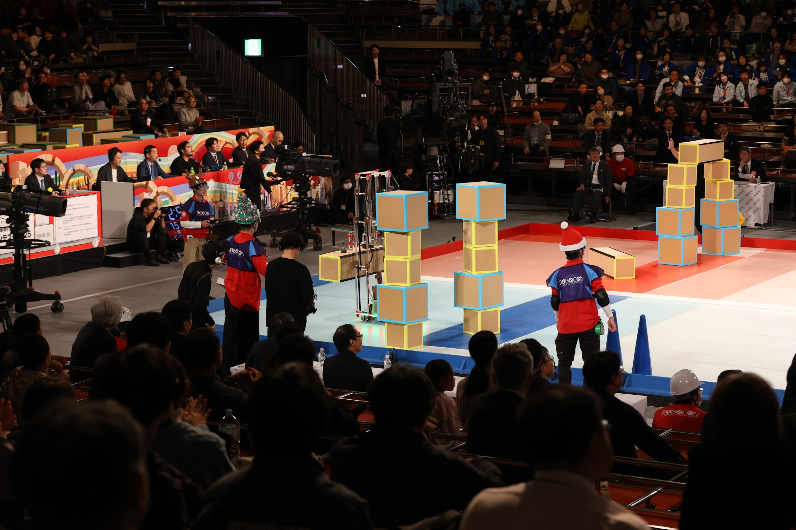

2025年11月16日、Aチーム「それゆけキサンタクロース」が高専ロボコン2025全国大会に出場しました。

*高専ロボコン2025 全国大会での「それゆけキサンタクロース」*

木更津高専としては昨年に続く2年連続の全国大会出場です。1回戦第8試合で一関高専と対戦し、接戦の末に惜しくも敗れました。思い描いていた動きを出し切れず、悔しさの残る試合でした。

それでも、地区大会を勝ち抜いて再び全国大会に出場し、その過程で多くの方に支えていただいたことは、今年の大切な経験になりました。会場で応援してくださった方々、学校内外で支えてくださった皆さま、本当にありがとうございました。

来年はさらに強くなって全国大会に戻れるよう、今回見つかった課題に取り組み、得られた経験を生かしていきます。

## 関連リンク

- [木更津高専公式ニュース「全国大会出場」](https://www.kisarazu.ac.jp/news/%E3%82%A2%E3%82%A4%E3%83%87%E3%82%A2%E5%AF%BE%E6%B1%BA%E3%83%BB%E5%85%A8%E5%9B%BD%E9%AB%98%E7%AD%89%E5%B0%82%E9%96%80%E5%AD%A6%E6%A0%A1%E3%83%AD%E3%83%9C%E3%83%83%E3%83%88%E3%82%B3%E3%83%B3%E3%83%86-5/)
